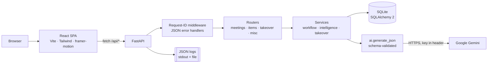
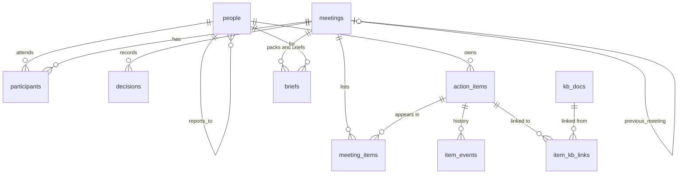

<div align="center">

# ⇄ Handover AI

### Never lose context when work changes hands.

An AI-assisted knowledge and task platform that captures what a team discussed and decided, hands that context to
the right person, and follows every open item until it is closed.

[**🚀 Live demo**](https://YOUR-APP.onrender.com) · [**📘 API docs**](https://YOUR-APP.onrender.com/docs) · [How to use](#-how-to-use) · [Run locally](#-run-locally)


</div>

> ⏳ **First visit may take ~1 minute.** The demo runs on Render's free plan, which sleeps when idle.

---

## 📸 Screenshots

| Who are you? (org chart) | Takeover Pack | AI recap review |
|:---:|:---:|:---:|
|  |  |  |

---

## 💡 The problem → the solution

Teams lose context when work changes hands: someone misses a meeting, goes on leave, or covers a role they don't
usually do, and action items silently slip.

**Handover AI** stores meetings and handovers as structured data: decisions, action items with owner, due date and
status, and a full history of every change. It **carries open items forward** instead of copying them, and turns messy
notes into a recap that a person reviews before saving. Whoever picks up the work gets a **role-aware Takeover Pack**:
what matters, what is new *for their role*, and what to do first.

---

## ✨ Features

- 🧑‍🤝‍🧑 **Org-aware**: a 16-person company hierarchy. Glowing cards show who has something waiting.
- 📥 **Personal inbox**: work handed to you, meetings you missed, handovers you gave, your open items.
- 🎒 **Role-aware Takeover Pack** *(the special feature)*: TL;DR, first moves, role gap, decisions, diagrams, who
  to ask, docs to read, and a readiness meter.
- 🤖 **AI recap**: paste or upload messy notes, chats or transcripts, and get a summary, decisions and action items
  with owners. Every line is checked against the notes, and you review it before anything is saved.
- 🔁 **Carry-forward with history**: open items move to the next meeting as the *same* item, with a full timeline.
- ✅ **Action-item tracker**: filter open, overdue or stale items; close with a recorded outcome; AI follow-up
  messages.
- 📚 **Knowledge base**: team docs plus every saved recap. The AI links items to the docs that help.
- 🛡️ **Reliable AI**: validated JSON, retries, post-checks, a labelled rule-based fallback when the AI is down.
- 🧾 **Structured logging**: JSON logs with a request ID, AI latency and outcome, no secrets.

---

## 🧭 How to use

There is no sign-up. You pick who you are from the org chart, and the app shows everything from that person's
point of view. You can switch at any time with **"Viewing as"** in the top-right corner.

### 1. Take over someone's work
1. On the home page click **I'm taking over work**.
2. Click your card. Try **Rahul Mehta**: he's covering for his manager Ananya while she is on leave.
3. In your inbox, open **Handover: Ananya → Rahul**.
4. Read the **Takeover Pack** from top to bottom:
   - **TL;DR**: the situation in three lines.
   - **Your first moves**: tick each one when it's done.
   - **Your role gap**: what's new for *you* and what you can ignore.
   - **Decisions you must respect**: click **Acknowledge** on each.
   - **Read these**: opening a document ticks it off.
5. Watch the **readiness meter** climb to 100%. Switch to **Ananya** to see that she can follow Rahul's readiness
   from her inbox.

> Every line in a pack has a small tag (`#12`, a meeting name). Click it to see where that information came from.

### 2. Catch up on a meeting you missed
1. On the home page click **I missed a meeting**, then pick **Rahul Mehta** (absent from *Billing Sync – Week 3*) or
   **Arjun Desai** (absent from the *design review*).
2. Open the meeting from **Meetings you missed** to get a lighter **Catch-up Pack**: what happened, decisions, your
   items and what to watch out for.

### 3. Turn messy notes into a recap
1. Go to **Meetings** → **Incident review: duplicate SMS bundle charges**.
2. The raw chat log is already in the **AI recap** box. You can also paste your own notes or **Upload .txt**.
3. Click **Generate recap** (about 15–20 seconds).
4. Review the draft:
   - 🟢 **quote found in notes**: the AI's source quote really appears in the text.
   - 🟠 **not traced to notes**: double-check this line.
   - Fix owners or dates, and delete anything wrong.
5. Click **Save recap**. This creates the action items, adds the recap to the knowledge base, and links the items to
   relevant docs.

### 4. Track and close action items
1. Go to **Action items**. Filter by **Open**, **Overdue**, **Stale (carried 2+)** or **Done**, or by owner.
2. Click any item to open its panel:
   - **Edit**: change status, owner or due date. Your note is saved in the history.
   - **Close with outcome**: required. Say what actually happened.
   - **AI follow-up**: drafts a friendly nudge to the owner. **Copy** it into Slack or email.
   - **History**: every event, from creation through carry-forwards to closing.

### 5. Create a meeting or a handover
1. **Meetings** → **New**.
2. **Meeting**: pick a *previous meeting in the series* and its open items are carried forward automatically.
3. **Handover**: pick who is handing over and who is taking over. All open items of the first person move to the
   second, with history.

---

## 🎒 Special feature: role-aware Takeover Pack

A plain task list is not enough when someone **steps into a different role**. The app knows the org hierarchy, so it
writes a pack tailored to the gap between the leaver's role and yours. For example, Rahul (Backend Engineer) covering
for Ananya (Engineering Manager) is told that approvals, running the weekly sync and finance follow-ups are now his.
He is also told what he can safely ignore.

**Why it adds value**
- 🎯 **Role context, not just tasks.** A peer handover and a step-up handover need different briefs.
- ✅ **Closes the loop.** The readiness meter is saved, and the person leaving can see whether the takeover landed.
- 🔍 **Traceable.** Every decision links to its source meeting and every action to its item. The AI may only
  reference ids that exist; anything else is removed and flagged.
- 📊 **Diagrams you can trust.** The timeline and workflow are built by code from the item history, not drawn by the
  AI.

---

## 🏗️ Architecture



**One deployable unit:** FastAPI serves both the API (`/api`) and the built React app.

<details>
<summary><b>📁 Project structure</b></summary>

```
handover-ai/
├── backend/
│   ├── app/
│   │   ├── main.py            app, request-ID middleware, error handlers, SPA serving, startup seed
│   │   ├── config.py          settings from environment variables
│   │   ├── logging_setup.py   JSON logs, request_id, file + stdout, secret redaction
│   │   ├── db.py · models.py  database engine and tables
│   │   ├── schemas.py         request/response validation (Pydantic)
│   │   ├── errors.py          consistent JSON errors
│   │   ├── serializers.py     database rows → API responses
│   │   ├── seed.py            Northwind Telecom demo data
│   │   ├── routers/           meetings · items · takeover · misc
│   │   └── services/          ai · intelligence · takeover · workflow
│   └── tests/test_app.py      16 tests (AI mocked, no network needed)
├── frontend/src/
│   ├── api.js · hooks.js · format.js
│   ├── components/            TopBar, Viewer, Toasts, ui, PackDiagrams, ItemDrawer
│   └── pages/                 Welcome, WhoAreYou, Inbox, TakeoverPack, Meetings,
│                              MeetingDetail, Items, KnowledgeBase, NotFound
├── samples/incident_review_notes.txt   messy chat log for the AI demo
└── Dockerfile · render.yaml · .env.example
```
</details>

<details>
<summary><b>🗃️ Data model</b></summary>



- **An action item is one row for its whole life.** `meeting_items` records every meeting it appeared in
  (`origin | carried | handover`), and `item_events` is an append-only history.
- `meetings.kind` is `meeting` or `handover`; status flows `scheduled → held → closed`.
- `briefs.kind` is `brief` (catch-up) or `takeover` (Takeover Pack); `checked` stores the readiness checklist.
- `people.level / team / reports_to_id` form the org hierarchy.
</details>

---

## 📋 Assignment requirements → how they're met

| # | Requirement | How it is met | Where in the app |
|---|---|---|---|
| 1 | Create/persist meetings or work transfers | `meetings` table with `kind = meeting \| handover`, participants, agenda, notes, decisions, items | Meetings → **New** |
| 2 | Manage lifecycle; track every item until closed | Meeting status flow; item status `open / in_progress / blocked / done / dropped`; every change is an event | Meeting status button · Action items |
| 3 | Carry open items forward with history | Same item linked to the next meeting + `carried_forward` event + `carry_count` | Create a meeting with a previous meeting · Week 4 sync |
| 4 | AI turns raw text into a structured recap | Gemini extracts summary, decisions, items, owners, due dates, source quotes; saved only after review | Meeting → **Generate recap** |
| 5 | AI catch-up brief | Catch-up briefs + Takeover Pack (handover and missed-meeting modes) | Inbox → pack · Meeting → **Quick brief** |
| 6 | Knowledge base; AI links items to it | Team docs + saved recaps; AI links items with reason and confidence | Knowledge base · "Read these" |
| 7 | Record the outcome of each item | Closing requires an outcome (≥ 5 characters), stored in the item and its history | Item → **Close with outcome** |
| 8 | Validation and error handling | Pydantic validation; consistent JSON errors with `request_id`; toasts show it | Everywhere |

---

## 🤖 AI configuration

| | |
|---|---|
| **Provider** | Google Gemini REST API (`generateContent`) |
| **Model** | `GEMINI_MODEL`, default `gemini-3.5-flash` (`gemini-2.5-flash` is no longer offered to new API keys) |
| **Settings** | `temperature 0.2`, JSON response mode, timeout `AI_TIMEOUT_S` (25 s), `AI_MAX_ATTEMPTS` (2) |
| **Key** | `GEMINI_API_KEY`, sent in the `x-goog-api-key` header, never in the URL, never logged |

| Feature | Output | Post-checks | Fallback when AI is down |
|---|---|---|---|
| **Recap** | summary, decisions, action items, open questions | owner must be a participant; quote must appear verbatim in the notes; bad dates flagged | keyword rules: `Decision:`/`Action:` lines; in chats `decision/agreed` → decision, `I'll / I can / <name> owns` → action owned by that person |
| **Takeover Pack** | TL;DR, role gap, decisions, next actions, who to ask, docs, risks | every decision/item/person/doc id must exist; unknown ids removed and shown as warnings; names and role titles taken from the database | prioritised by overdue → blocked → most-carried → due date |
| **Catch-up brief** | headline, what happened, decisions, your items, watch-outs | — | built from the meeting summary and items |
| **KB linking** | item → doc links with reason and confidence | ids must exist; confidence ≥ 0.5 | keyword overlap |
| **Follow-up nudge** | subject + message | — | template message |

**How the AI is kept reliable**
1. **JSON only, validated** against a schema. Invalid output is never used.
2. **Retries** on timeout, 429/5xx or invalid JSON. On invalid JSON the error is fed back to the model. Config errors
   (400/401/403/404) fail fast.
3. **Post-checks** against the database (table above).
4. **Human review.** A recap is a draft until you save it, and your raw notes are saved first.
5. **Labelled fallbacks.** The UI shows ✦ *AI generated* or *Rule-based fallback*.
6. **Prompt-injection guard.** User text is wrapped in tags and treated as data, not instructions.

---

## 🧾 Logging

- **Format:** one JSON object per line: `ts, level, logger, request_id, message, event`, plus fields.
- **Where:** stdout and a rotating file (`LOG_FILE`, default `backend/logs/app.log`, 5 MB × 3).
- **Request ID:** taken from the `X-Request-ID` header or generated. It is on every log line, in the response header
  and in every error body; the UI shows it in error toasts.
- **Levels:** `INFO` normal · `WARNING` 4xx, validation errors, failed AI attempts · `ERROR` AI gave up, unhandled
  errors (with stack trace).
- **AI calls:** `event=ai_call` with `operation, model, attempt, latency_ms, outcome`. Prompt contents are never
  logged.
- **No secrets:** a redaction filter masks API keys and sensitive fields. A test checks this.

<details>
<summary><b>Key events and example log lines</b></summary>

Events: `http_request`, `meeting_created`, `meeting_updated`, `meeting_status_changed`, `meeting_carry_forward`,
`handover_applied`, `item_created`, `item_updated`, `item_reassigned`, `item_status_changed`, `item_carried_forward`,
`item_closed`, `item_reopened`, `item_kb_linked`, `item_nudge_drafted`, `recap_drafted`, `recap_applied`,
`brief_generated`, `takeover_pack_generated`, `takeover_progress_updated`, `validation_error`, `app_error`,
`unhandled_error`, `seed_created`.

A real run. Gemini was busy (503), the client retried, and attempt 2 succeeded. Both lines share one request ID:
```json
{"ts": "2026-10-30T07:27:59.071+00:00", "level": "WARNING", "logger": "app.ai", "request_id": "cd3bf06bfe90", "message": "AI call attempt failed", "event": "ai_call", "operation": "recap", "model": "gemini-3.5-flash", "attempt": 1, "latency_ms": 3653, "outcome": "http_error", "http_status": 503}
{"ts": "2026-10-30T07:28:15.018+00:00", "level": "INFO", "logger": "app.ai", "request_id": "cd3bf06bfe90", "message": "AI call succeeded", "event": "ai_call", "operation": "recap", "model": "gemini-3.5-flash", "attempt": 2, "latency_ms": 14946, "outcome": "success", "prompt_chars": 2004, "response_chars": 2346}
{"ts": "2026-10-30T06:57:51.091+00:00", "level": "INFO", "logger": "app.workflow", "request_id": "startup", "message": "Handed over from Priya Nair to Arjun Desai in 'Handover: Priya -> Arjun (leave Nov 2-16)'", "event": "item_reassigned", "item_id": 6, "meeting_id": 4, "from_owner_id": 6, "to_owner_id": 7, "via": "handover"}
```
</details>

---

## 🏢 Demo data: Northwind Telecom

The app seeds itself on first start, with dates relative to today so "overdue" is always meaningful.

- **16 people** under a Head of Engineering: **Billing Platform**, **Network OSS** and **Product & Design** teams.
- **Billing Sync weeks 1–4.** The INC-142 fix has been carried forward 3 times, some items are overdue, and Rahul
  missed week 3.
- **Three handovers:** Priya → Arjun (leave cover), **Ananya → Rahul** (engineer acting as manager), Ishaan → Neha
  (on-call).
- **Network OSS weekly** (Aditya absent) and a **portal design review** (Arjun absent).
- **7 team documents:** runbooks, API spec, postmortem, roadmap, QA checklist, comms guidelines, manager playbook.
- **Incident review** with only a raw, messy chat log, ready for the live AI recap.

---

<details>
<summary><b>🔌 API reference</b> (interactive docs at <code>/docs</code>)</summary>

| Method | Path | Purpose |
|---|---|---|
| GET | `/api/health` | Health + whether AI is configured |
| GET · POST | `/api/people` | List / create people |
| GET | `/api/org` | Org tree with "waiting" counts |
| GET | `/api/people/{id}/inbox` | Handovers to me, missed meetings, handed over by me, my open items |
| GET · POST | `/api/meetings` | List / create (auto carry-forward, auto handover) |
| GET · PATCH | `/api/meetings/{id}` | Detail / update (status transitions validated) |
| POST | `/api/meetings/{id}/carry-forward?from_meeting_id=` | Carry open items from another meeting |
| POST | `/api/meetings/{id}/recap` | AI recap **draft** (nothing saved except raw notes) |
| POST | `/api/meetings/{id}/recap/apply` | Save a reviewed recap |
| POST | `/api/meetings/{id}/kb-links` | Re-run AI linking of items to docs |
| POST | `/api/meetings/{id}/briefs` | Catch-up brief for a person |
| POST · GET | `/api/meetings/{id}/takeover-pack` | Generate / fetch the latest Takeover Pack |
| PATCH | `/api/takeover-packs/{id}/progress` | Update the readiness checklist |
| GET · POST | `/api/items` | List (filters: `open_only, overdue, stale, owner_id, status`) / create |
| GET · PATCH | `/api/items/{id}` | Detail with history / update (closing requires an outcome) |
| POST | `/api/items/{id}/nudge` | AI follow-up draft |
| GET · POST | `/api/kb`, GET `/api/kb/{id}` | Knowledge base |
| GET | `/api/dashboard` | Counts, overdue, stale, upcoming meetings, recent activity |

Errors always look like:
```json
{"error": {"code": "invalid_state", "message": "...", "details": {}, "request_id": "f7726e1900ab"}}
```
</details>

---

## 💻 Run locally

**Requirements:** Python 3.11+ and Node 20+.

```bash
git clone https://github.com/Jayom45/case-study-digi.git
cd case-study-digi

# 1. Backend dependencies
python -m venv .venv
.venv\Scripts\activate              # macOS/Linux: source .venv/bin/activate
pip install -r backend/requirements.txt

# 2. Configuration
cp .env.example .env                # then put your GEMINI_API_KEY in .env (optional)

# 3. Build the frontend
cd frontend && npm install && npm run build && cd ..

# 4. Start
cd backend && uvicorn app.main:app --reload --port 8000
```

Open **http://localhost:8000**. API docs are at **/docs**.

| Task | Command |
|---|---|
| Frontend with live reload | `cd frontend && npm run dev` → http://localhost:5173 (backend must be running) |
| Run tests | `python -m pytest -q` (from the repo root) |
| Reset demo data | delete `backend/data/app.db*` and restart |

> No Gemini key? Everything still works. AI features use the rule-based fallback and are labelled as such.

### Environment variables

| Variable | Default | Meaning |
|---|---|---|
| `GEMINI_API_KEY` | *(empty)* | Gemini key; empty = fallbacks only |
| `GEMINI_MODEL` | `gemini-3.5-flash` | Model name |
| `AI_TIMEOUT_S` | `25` | Per-attempt timeout (seconds) |
| `AI_MAX_ATTEMPTS` | `2` | Attempts per AI call |
| `LOG_LEVEL` | `INFO` | Log level |
| `LOG_FILE` | `backend/logs/app.log` | Log file path |
| `DATABASE_URL` | `sqlite:///backend/data/app.db` | Database URL |
| `SEED_ON_START` | `true` | Seed demo data when the database is empty |
| `MAX_NOTES_CHARS` | `20000` | Max length of notes for a recap |

---

## ☁️ Deploy (Render)

The repo includes `render.yaml` and a two-stage `Dockerfile`: stage 1 builds React, stage 2 runs FastAPI, which
serves it.

1. On [render.com](https://render.com): **New + → Blueprint** → select this repo.
2. Enter `GEMINI_API_KEY` when asked. Everything else is preset.
3. Deploy. The health check is `/api/health`. Every `git push` to `main` redeploys.

---

## 📌 Assumptions & known limitations

**Assumptions**
- No login: "Viewing as" picks a persona from the org chart. Fine for a demo, not for production.
- Input is text (notes, chats, transcripts, emails), pasted or uploaded as `.txt`, `.md` or `.log`.
- One organisation, one timezone.

**Known limitations**
- **Data resets on redeploy.** Free hosting uses SQLite on a temporary disk; demo data is re-seeded. Production would
  use Postgres via `DATABASE_URL`.
- **No schema migrations.** After model changes the local database must be deleted (production: Alembic).
- **AI can still be wrong.** Post-checks catch invented people, quotes and ids, but not every wrong sentence. That is
  why recaps are reviewed by a human.
- **AI calls are synchronous** (about 15–20 s for a recap); a background job queue would be better at scale.
- No PDF/DOCX parsing; saved decisions can't be edited from the UI.
- **Free plan cold start:** the first request after idling takes about a minute.

---

<div align="center">

Built by **Jayom Shingte** for the DigiPlus IT technical assessment · FastAPI · React · Gemini

</div>
