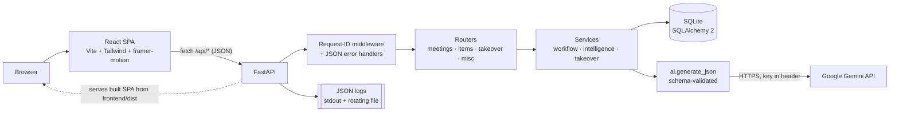
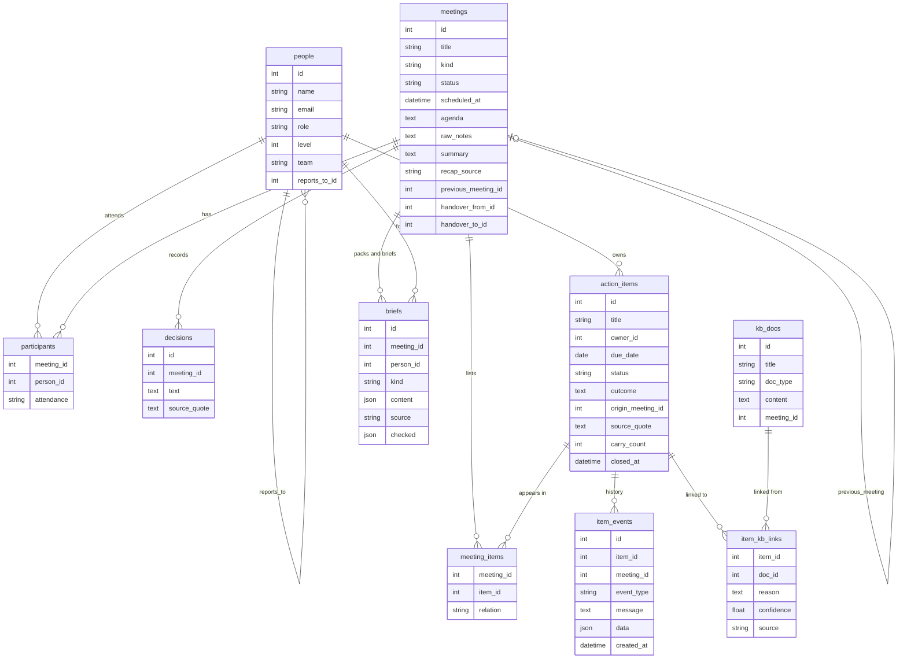

# Handover AI

**Never lose context when work changes hands.** An AI-assisted knowledge and task platform that captures what a team
discussed and decided, hands that context to the right person, and follows open items until they are closed.

**Live demo:** `<live-url>` *(planned: Render deploy)* · **API docs:** `<live-url>/docs`

| Org chart ("Who are you?") | Takeover Pack | Inbox |
|---|---|---|
|  *(placeholder)* |  *(placeholder)* |  *(placeholder)* |

---

## Problem → solution

Teams lose context when work changes hands: someone misses a meeting, goes on leave, or covers a role they don't
usually do, and action items silently slip. Handover AI stores meetings and work handovers as structured data
(decisions, action items with owner/due/status, and a full event history). It carries open items forward instead of
copying them, and uses AI to turn messy notes into a reviewed recap. Whoever picks up the work gets a
**role-aware Takeover Pack**: what matters, what is new *for their role*, and what to do first.

## How the assignment's required outcomes are met

| # | Requirement | How it is met | Where |
|---|---|---|---|
| 1 | Create/persist meetings or work transfers (agenda, participants, notes, decisions, action items) | `meetings` table with `kind = meeting \| handover`; participants with attendance; decisions; items. SQLite via SQLAlchemy. | `POST /api/meetings` · Meetings → New (meeting or handover) |
| 2 | Manage lifecycle; track every item (owner, due, status) until closed | Meeting status machine `scheduled → held → closed`; item status `open / in_progress / blocked / done / dropped`; every change is an `item_events` row | `PATCH /api/meetings/{id}`, `PATCH /api/items/{id}` · Meeting status button; Action items tracker (filters open/overdue/stale/done, owner, search) + item drawer with full history |
| 3 | Carry open items forward, keeping history | One item row for its whole life; carrying links it to the next meeting (`meeting_items`) and appends a `carried_forward` event; `carry_count` flags stale items | Creating a meeting with `previous_meeting_id` auto-carries · Week 4 sync in seed data |
| 4 | AI turns raw text into a structured recap | Gemini extracts summary, decisions, action items, owners, due dates and source quotes. Saved only after the user reviews the draft. | `POST /api/meetings/{id}/recap` → `/recap/apply` · Meeting detail → paste/upload notes → review draft → Save |
| 5 | AI catch-up brief for absentees / people taking over | Catch-up briefs plus the **Takeover Pack** (handover and missed-meeting modes) | `POST /api/meetings/{id}/briefs`, `POST /api/meetings/{id}/takeover-pack` · Inbox → pack |
| 6 | Small knowledge base; AI links items to it | `kb_docs` (team documents + every applied meeting recap); AI links items to docs with a reason and confidence | `GET/POST /api/kb`, `POST /api/meetings/{id}/kb-links` · Knowledge base page, "Read these" |
| 7 | Record the outcome of each item | Closing (`done`/`dropped`) requires an outcome of at least 5 characters; stored on the item and in its history | `PATCH /api/items/{id}` · Item drawer → "Close with outcome" |
| 8 | Validation and error handling | Pydantic schemas at the edge; domain errors return `{"error": {code, message, details, request_id}}`; UI toasts show the request id | `schemas.py`, `errors.py`, `main.py` · toasts |

## Special feature: role-aware Takeover Pack

The app knows **who you are** (from the org hierarchy) and **who you are taking over from**. A Takeover Pack is a
concise brief tailored to the gap between the two roles. For example, Rahul (Backend Engineer) covering for Ananya
(Engineering Manager) is told that approvals, running the weekly sync and finance follow-ups are now his. He is also
told what he can safely ignore.

The pack contains:
- **TL;DR** (max 3 lines)
- **Your first moves**: a prioritised checklist
- **Your role gap**: from-role → to-role, new for you / can ignore
- **Decisions you must respect**, each linked to its source meeting
- **State of work**: workflow diagram by status
- **Where they left off**: timeline built from the item history
- **Who to ask**
- **Read these**: linked knowledge-base docs
- **Watch out**: risks plus AI quality-check warnings

A **readiness meter** (0–100%) rises as the person ticks actions, acknowledges decisions and opens the docs. Progress
is stored, and the person who handed over sees it in their inbox ("Arjun is 60% ready").

**Why it adds value**
- Handovers fail on *role* context, not just task lists. A peer handover and a step-up handover need different briefs.
- The readiness meter closes the loop: the leaver can confirm the takeover actually landed before going on leave.
- Every line is traceable to a meeting or item id, so the brief can be trusted and checked.

## Architecture



One deployable unit: FastAPI serves both `/api` and the built React app.

```
handover-ai/
├── backend/
│   ├── app/
│   │   ├── main.py            app, request-ID middleware, error handlers, SPA serving, startup seed
│   │   ├── config.py          settings from environment variables
│   │   ├── logging_setup.py   JSON formatter, request_id context, file + stdout, secret redaction
│   │   ├── db.py · models.py  SQLAlchemy engine/session and schema
│   │   ├── schemas.py         Pydantic request/response models (validation)
│   │   ├── errors.py          domain errors → consistent JSON error body
│   │   ├── serializers.py     ORM → API shapes
│   │   ├── seed.py            Northwind Telecom demo data
│   │   ├── routers/           meetings.py · items.py · takeover.py · misc.py
│   │   └── services/          ai.py · intelligence.py · takeover.py · workflow.py
│   └── tests/test_app.py      16 API tests (AI mocked)
├── frontend/
│   └── src/
│       ├── api.js · hooks.js · format.js
│       ├── components/        TopBar, Viewer (persona), Toasts, ui, PackDiagrams, ItemDrawer
│       └── pages/             Welcome, WhoAreYou, Inbox, TakeoverPack, Meetings, MeetingDetail, Items, KnowledgeBase, NotFound
├── samples/incident_review_notes.txt   messy chat log for the live AI demo
├── Dockerfile · render.yaml · .env.example
```

## Data model



Key ideas:
- **An action item is one row for its whole life.** `meeting_items.relation` (`origin | carried | handover`) records
  every meeting it appeared in, and `item_events` is an append-only history.
- `briefs.kind` is `brief` (catch-up) or `takeover` (Takeover Pack). `checked` stores the readiness checklist.

## AI

- **Provider:** Google Gemini REST API (`generateContent`), model from `GEMINI_MODEL` (default `gemini-3.5-flash`; `gemini-2.5-flash` is no longer offered to new API keys),
  `temperature 0.2`, `responseMimeType: application/json`. Key from `GEMINI_API_KEY`, sent in the `x-goog-api-key`
  header (never in the URL, never logged).
- **One client:** every AI call goes through `services/ai.py → generate_json(operation, system, prompt, schema)`.

| Feature | Endpoint | Output | Post-checks | Fallback |
|---|---|---|---|---|
| Recap extraction | `POST /meetings/{id}/recap` | summary, decisions, action items (owner, due, source quote), open questions | owner must be a participant; quote must appear verbatim in the notes (`quote_verified`); unreadable dates flagged | keyword rules: `Action:`/`Decision:` lines; in chat logs `decision/agreed` → decision, `I'll / I can / <name> owns` → action owned by the speaker/named person |
| Catch-up brief | `POST /meetings/{id}/briefs` | headline, what happened, decisions, your items, watch-outs | — | built from meeting summary and items |
| Takeover Pack | `POST /meetings/{id}/takeover-pack` | tldr, role_gap, key_decisions, next_actions, who_to_ask, read_these, risks | every decision/item/person/doc id must exist; unknown ids removed and shown as warnings; text re-filled from the DB; role names always taken from the DB | prioritised by overdue → blocked → most-carried → due date |
| KB linking | on recap apply, `POST /meetings/{id}/kb-links` | item → doc links with reason and confidence | ids must exist; confidence ≥ 0.5 | keyword overlap |
| Follow-up nudge | `POST /items/{id}/nudge` | subject, message | — | template message |

**Reliability design**
1. **JSON only, schema-validated.** Output is parsed and validated with a Pydantic model. Invalid output is never
   trusted.
2. **Retries.** Timeout (`AI_TIMEOUT_S`), up to `AI_MAX_ATTEMPTS`. Retries on timeout, 429/5xx and invalid JSON. On
   invalid JSON the validation error is fed back to the model. 400/401/403/404 fail fast (config problem).
3. **Post-checks** (table above): the model's references are checked against the database.
4. **Human review.** The recap is a *draft*. Nothing is saved until the user applies it; raw notes are saved first so
   input is never lost.
5. **Fallbacks.** If the AI is not configured or fails, a deterministic result is returned with `source: "fallback"`,
   labelled in the UI ("Rule-based fallback").
6. **Prompt-injection guard.** User content is wrapped (`<notes>`, `<input>`), and the system prompt says it is data,
   not instructions, and forbids inventing people, dates or facts.
7. **Diagrams are drawn by code, not by the AI.** The timeline and workflow come from `item_events` and statuses, so
   bad model output cannot break them.

## Logging

- **Format:** one JSON object per line: `ts, level, logger, request_id, message, event` plus structured fields.
- **Where:** stdout and a rotating file (`LOG_FILE`, default `backend/logs/app.log`, 5 MB × 3 backups).
- **Request ID:** taken from the `X-Request-ID` header or generated, stored in a context variable, added to every log
  line, echoed in the `X-Request-ID` response header and in every error body.
- **Levels:** `INFO` for normal events, `WARNING` for 4xx, validation errors and failed AI attempts, `ERROR` for AI
  config errors, AI giving up and unhandled exceptions (with stack trace).
- **Key events:** `http_request`, `meeting_created`, `meeting_updated`, `meeting_status_changed`,
  `meeting_carry_forward`, `handover_applied`, `item_created`, `item_updated`, `item_reassigned`,
  `item_status_changed`, `item_carried_forward`, `item_closed`, `item_reopened`, `item_kb_linked`,
  `item_nudge_drafted`, `recap_drafted`, `recap_applied`, `brief_generated`, `takeover_pack_generated`,
  `takeover_progress_updated`, `validation_error`, `app_error`, `unhandled_error`, `seed_created`.
- **AI calls:** `event=ai_call` with `operation, model, attempt, latency_ms, outcome`
  (`success | timeout | http_error | invalid_output | error | not_configured | failed`) and prompt/response sizes.
  Prompt contents are not logged.
- **No secrets:** a redaction pass masks API-key patterns and sensitive keys (`api_key`, `authorization`, `token`, …)
  in every line. A test asserts the test key never appears in the log file.

Example lines (from a real run). Gemini was busy (503), the client retried, and attempt 2 succeeded. Both lines share
one request ID:
```json
{"ts": "2026-10-30T07:27:59.071+00:00", "level": "WARNING", "logger": "app.ai", "request_id": "cd3bf06bfe90", "message": "AI call attempt failed", "event": "ai_call", "operation": "recap", "model": "gemini-3.5-flash", "attempt": 1, "latency_ms": 3653, "outcome": "http_error", "http_status": 503}
{"ts": "2026-10-30T07:28:15.018+00:00", "level": "INFO", "logger": "app.ai", "request_id": "cd3bf06bfe90", "message": "AI call succeeded", "event": "ai_call", "operation": "recap", "model": "gemini-3.5-flash", "attempt": 2, "latency_ms": 14946, "outcome": "success", "prompt_chars": 2004, "response_chars": 2346}
{"ts": "2026-10-30T06:57:51.091+00:00", "level": "INFO", "logger": "app.workflow", "request_id": "startup", "message": "Handed over from Priya Nair to Arjun Desai in 'Handover: Priya -> Arjun (leave Nov 2-16)'", "event": "item_reassigned", "item_id": 6, "meeting_id": 4, "from_owner_id": 6, "to_owner_id": 7, "via": "handover"}
```

## Data source

Seeded on first start (`SEED_ON_START=true`) with a realistic **Northwind Telecom** engineering org. Dates are relative
to today, so "overdue" always means something.

- **16 people in a hierarchy:** Head of Engineering → Billing Platform, Network OSS, Product & Design teams.
- **Billing Sync weeks 1–4.** The INC-142 fix has been carried 3 times (stale). There are overdue items, and Rahul was
  absent in week 3. Week 4 is scheduled, with open items auto-carried.
- **Three handovers:**
  - Priya → Arjun (peer, leave cover)
  - **Ananya → Rahul** (engineer acting as manager: the role-gap demo)
  - Ishaan → Neha (SRE on-call cover)
- **More meetings:** Network OSS weekly (Aditya absent) and a portal design review (Arjun absent).
- **7 team documents:** runbooks, API spec, postmortem, roadmap, QA checklist, comms guidelines, EM playbook. Every
  meeting recap also becomes a KB doc.
- **Live AI demo:** an incident review with only a raw, messy chat log (`samples/incident_review_notes.txt`).

## API overview

All under `/api`; interactive docs at `/docs`.

| Method | Path | Purpose |
|---|---|---|
| GET | `/health` | Health + whether AI is configured |
| GET / POST | `/people` | List / create people (with level, team, reports_to) |
| GET | `/org` | Org tree with "waiting" badge counts per person |
| GET | `/people/{id}/inbox` | Handovers to me, missed meetings, handed over by me (with receiver readiness), my open items |
| GET / POST | `/meetings` | List (filter `kind`, `status`) / create (auto carry-forward, auto handover) |
| GET / PATCH | `/meetings/{id}` | Detail / update (status transitions validated) |
| POST | `/meetings/{id}/carry-forward?from_meeting_id=` | Carry open items from another meeting |
| POST | `/meetings/{id}/recap` | AI recap **draft** (nothing saved except raw notes) |
| POST | `/meetings/{id}/recap/apply` | Save a reviewed recap: summary, decisions, items, KB doc, AI KB links |
| POST | `/meetings/{id}/kb-links` | Re-run AI linking of items to KB docs |
| POST | `/meetings/{id}/briefs` | Catch-up brief for a person |
| POST / GET | `/meetings/{id}/takeover-pack` | Generate / fetch latest Takeover Pack (`person_id`) |
| PATCH | `/takeover-packs/{id}/progress` | Update readiness checklist (keys validated) |
| GET / POST | `/items` | List (filters `open_only, overdue, stale, owner_id, status`) / create |
| GET / PATCH | `/items/{id}` | Detail with history and meetings / update (closing requires outcome) |
| POST | `/items/{id}/nudge` | AI follow-up message draft |
| GET / POST | `/kb`, GET `/kb/{id}` | Knowledge base |
| GET | `/dashboard` | Counts, overdue, stale, upcoming meetings, owner load, recent activity |

## Run locally

Requires Python 3.11+ and Node 20+.

```bash
python -m venv .venv
.venv\Scripts\activate            # macOS/Linux: source .venv/bin/activate
pip install -r backend/requirements.txt
cp .env.example .env              # add GEMINI_API_KEY (optional: without it, fallbacks are used)

cd frontend && npm install && npm run build && cd ..
cd backend && uvicorn app.main:app --reload --port 8000
# open http://localhost:8000  (API docs: /docs)
```

- **Frontend live reload:** keep the backend running, then `cd frontend && npm run dev` → http://localhost:5173
  (Vite proxies `/api` to :8000).
- **Reset demo data:** delete `backend/data/app.db*` and restart.
- **Tests:** `python -m pytest -q` from the repo root (16 tests; AI is mocked, no network needed).

## Deploy (Render) *(planned)*

`render.yaml` + `Dockerfile` build one image. Stage 1 builds the React app; stage 2 runs FastAPI, which serves it.
Create a Render Blueprint from the repo and set `GEMINI_API_KEY` in the dashboard. The health check is `/api/health`.

## Environment variables

| Variable | Default | Meaning |
|---|---|---|
| `GEMINI_API_KEY` | *(empty)* | Gemini key. Empty = AI disabled, fallbacks used |
| `GEMINI_MODEL` | `gemini-3.5-flash` | Model name |
| `AI_TIMEOUT_S` | `25` | Per-attempt timeout (seconds) |
| `AI_MAX_ATTEMPTS` | `2` | Attempts per AI call |
| `LOG_LEVEL` | `INFO` | Log level |
| `LOG_FILE` | `backend/logs/app.log` | Log file path |
| `DATABASE_URL` | `sqlite:///backend/data/app.db` | SQLAlchemy URL |
| `SEED_ON_START` | `true` | Seed demo data when the DB is empty |
| `MAX_NOTES_CHARS` | `20000` | Max raw-notes length for a recap |

## Assumptions

- No authentication: "Viewing as" picks a persona from the org chart (kept in the browser). Fine for a demo, not for
  production.
- Input is pasted text (notes, chats, transcripts, emails). Audio transcription and file parsing are out of scope.
- One organisation, one timezone. Dates are shown in the browser's locale.

## Known limitations

- **SQLite on a free host resets on redeploy.** Demo data is re-seeded; a production setup would use Postgres via
  `DATABASE_URL`.
- **No schema migrations.** After model changes, delete the local DB (a production setup would add Alembic).
- **The AI can still be wrong.** Post-checks catch invented ids, unknown owners and unverifiable quotes, but not every
  wrong summary. That is why the recap is a reviewed draft.
- File upload accepts plain-text files only (`.txt`, `.md`, `.log`); PDF/DOCX parsing is not supported.
- No editing or deleting of saved decisions from the UI (items can be edited, closed and reopened).
- The org-chart badge counts are computed per request (fine for tens of people, not thousands).
